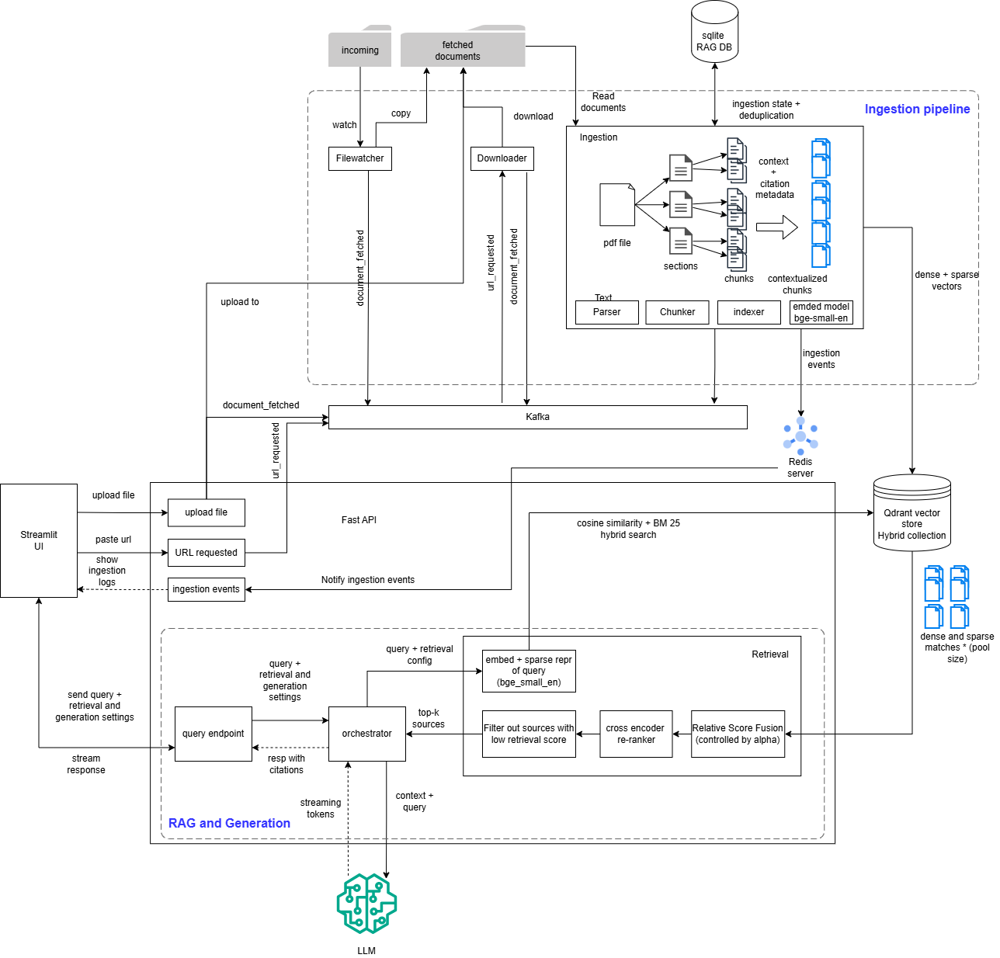
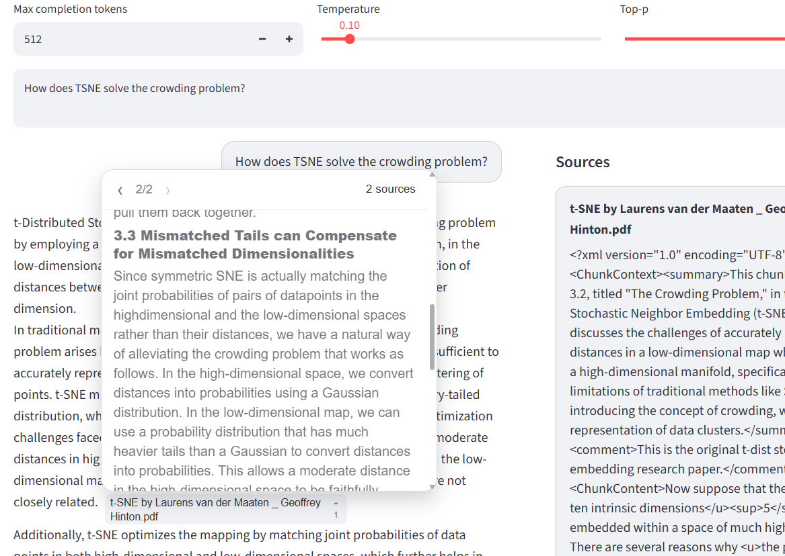
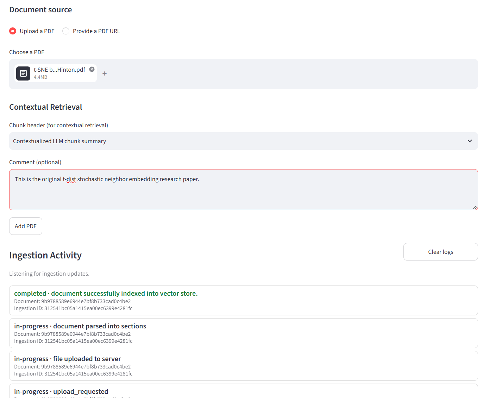
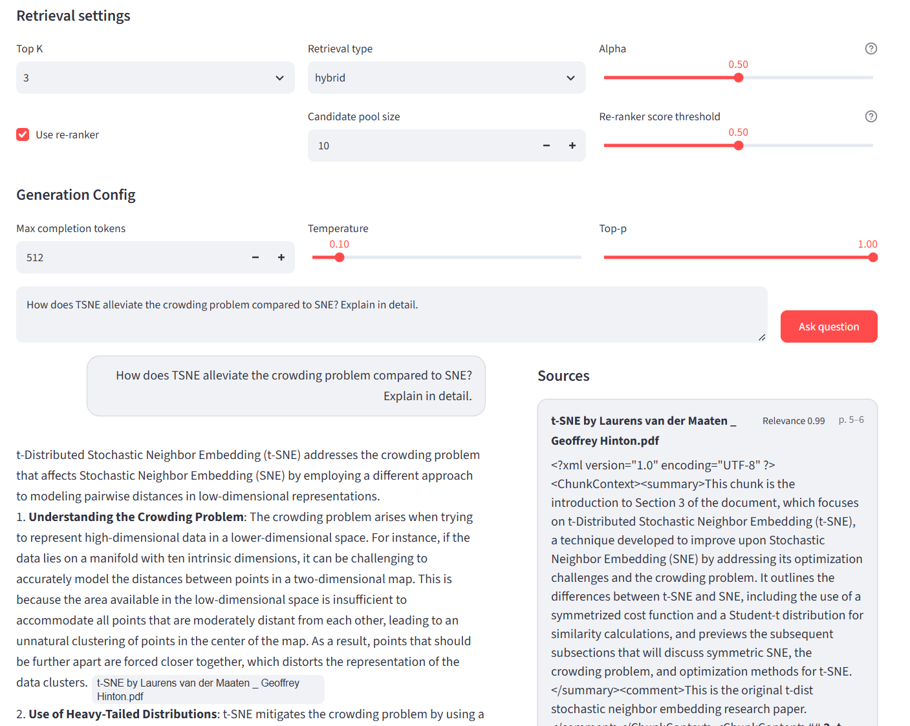

# RAG Architecture POC

A locally runnable Retrieval-Augmented Generation (RAG) application for
ingesting PDF documents, retrieving relevant passages, and generating answers
grounded in those documents with source citations.

This engineering-focused proof of concept combines an asynchronous,
event-driven ingestion pipeline with configurable retrieval, cross-encoder
reranking, streaming answer generation, a Streamlit UI, and API tracing. The
services are designed to run together locally with Docker Compose.

## Table of Contents

- [Overview](#overview)
- [Key Features](#key-features)
- [Technology Stack](#technology-stack)
- [Getting Started](#getting-started)
- [Architecture](#architecture)
- [Document Parsing and Chunking](#document-parsing-and-chunking)
- [Deduplication and Idempotency](#deduplication-and-idempotency)
- [Retrieval and Reranking](#retrieval-and-reranking)
- [Answer Generation and Citations](#answer-generation-and-citations)
- [User Interface](#user-interface)
- [Observability and Debugging](#observability-and-debugging)
- [Testing and Validation](#testing-and-validation)
- [Configuration Reference](#configuration-reference)
- [Design Decisions and Trade-offs](#design-decisions-and-trade-offs)
- [Limitations and Future Improvements](#limitations-and-future-improvements)
- [License](#license)

## Overview

The project has three user-facing capabilities:

1. Submit a PDF by upload or provide an HTTP(S) URL to a PDF.
2. Follow ingestion progress while the document is parsed, chunked, and indexed.
3. Ask questions over indexed documents and receive a streamed, source-cited answer.

The API accepts document submissions and returns an ingestion ID; processing continues asynchronously. Queries are handled by the API's retrieval and generation pipeline. Qdrant stores vector data, SQLite stores document hashes and ingestion state, Kafka coordinates ingestion work, and Redis publishes live ingestion-state updates.

## Key Features

- PDF upload, PDF URL download, and local folder-based ingestion.
- Event-driven processing through Kafka topics for URL requests and fetched documents.
- PDF-to-Markdown parsing into logical sections, followed by section-bounded chunking and Qdrant indexing.
- Dense, sparse BM25, or hybrid retrieval, with an optional cross-encoder reranker and filtering.
- Server-sent events (SSE) for streamed query answers and ingestion updates.
- Answer parts linked to retrieved source chunks and their document metadata.
- Configurable OpenAI, Gemini, or Anthropic LLM providers.
- Docker Compose services for the API, UI, ingestion workers, Kafka, Qdrant, Redis, and Jaeger.

## Technology Stack

| Area | Component |
| --- | --- |
| API | FastAPI |
| UI | Streamlit |
| Dependency management | `uv` workspace |
| Ingestion coordination | Apache Kafka |
| PDF extraction | PyMuPDF4LLM, with Markdown heading parsing |
| Chunking and RAG orchestration | LlamaIndex |
| Dense embeddings | FastEmbed with `BAAI/bge-small-en-v1.5` |
| Sparse retrieval | Qdrant BM25 sparse vectors |
| Vector database | Qdrant |
| Document and ingestion state | SQLite |
| Ingestion notifications | Redis Pub/Sub |
| LLM and reranking | Configured LLM provider; FastEmbed cross-encoder reranker |
| Tracing | OpenTelemetry OTLP to Jaeger |
| Local deployment | Docker Compose |

## Getting Started

### Prerequisites

- Docker Engine and the Docker Compose v2 plugin.
- An OpenAI API key for the default LLM configuration. Gemini and Anthropic adapters are also available if both service configs are changed accordingly.
- Git, if cloning the repository.

The Python packages currently require Python `>=3.13,<3.14`. The Docker images
use Python 3.13, so a local Python installation is not needed to run the
containerized stack.

### Configure environment

From the repository root, create a local `.env` file and edit it with your
credentials and local Compose settings:

```bash
cp .env.example .env
```

At minimum, replace the `OPENAI_API_KEY` placeholder. Keep the remaining
service addresses pointed at their Compose service names when running in
Docker:

```dotenv
OPENAI_API_KEY=replace-with-your-key
GOOGLE_API_KEY=
ANTHROPIC_API_KEY=
HF_TOKEN=
QDRANT_URL=http://qdrant:6333
DB_REL_PATH=database/rag.db
RAG_API_BASE_URL=http://api:8000
REDIS_HOST=redis
REDIS_PORT=6379
REDIS_DB=0
```

Only the credential for the selected LLM provider is needed. The default LLM model is
`gpt-4o-mini`. Embedding and reranker model files are cached in the mounted
`.models` directory and may take time to download on the first run.

### Start the stack

```bash
docker compose up --build -d
docker compose ps
```

To follow service logs:

```bash
docker compose logs -f api ui ingestion downloader filewatcher
```

The first start may take longer while Docker builds the Python images and
downloads models.

### Open the local services

| Service | URL |
| --- | --- |
| Streamlit UI | <http://localhost:8501> |
| FastAPI Swagger UI | <http://localhost:8000/docs> |
| FastAPI ReDoc | <http://localhost:8000/redoc> |
| FastAPI OpenAPI schema | <http://localhost:8000/openapi.json> |
| API health check | <http://localhost:8000/health> |
| Qdrant dashboard | <http://localhost:6333/dashboard> |
| Jaeger UI | <http://localhost:16686> |

Kafka and Redis are exposed on host ports `9092` and `6379`; the application
containers communicate with them using the internal Compose names `kafka` and
`redis`. Jaeger accepts OTLP on `4317` (gRPC) and `4318` (HTTP).

### Submit documents

Use **Add Documents** in the UI to upload a PDF or provide a PDF URL. The API
also exposes `POST /api/v1/documents` for either input type. It expects
`multipart/form-data` with exactly one of `file` or `url`; optional form fields
are `chunk_header_type` and `comment`. The endpoint responds with HTTP 202 and
an `ingestion_id`.

For local folder-based ingestion, copy a PDF into `staging/incoming/`. The
filewatcher waits for the file to stop changing, copies it into
`staging/fetched/<ingestion-id>/`, and publishes a `document.fetched` event.
The watcher removes the original file from `staging/incoming/` after a
successful copy.

### Stop the stack

```bash
docker compose down
```

This stops and removes the containers while preserving the named Kafka data
volume and the Qdrant storage bind mount. Do not use `docker compose down -v`
unless you intend to remove the named volumes.

## Architecture

The following diagram shows the end-to-end ingestion, query, persistence, and
notification flows:



### Component notes

- **Filewatcher:** watches `staging/incoming/`, waits for a stable file, copies
  it into a per-ingestion directory under `staging/fetched/`, then publishes a
  `document.fetched` Kafka event.
- **Downloader:** consumes `url.requested`, accepts HTTP(S) responses identified
  as PDFs, validates the PDF signature, writes the file under
  `staging/fetched/`, and publishes `document.fetched`.
- **Upload API:** validates the uploaded PDF, writes it under
  `staging/fetched/`, and publishes `document.fetched` directly.
- **Kafka:** coordinates the `url.requested` and `document.fetched` work
  queues. The ingestion worker consumes fetched-document events.
- **Ingestion worker:** checks the file hash, parses sections, chunks each
  section, adds contextual headers and citation metadata, indexes new chunks,
  updates ingestion state, and acknowledges processed Kafka messages.
- **SQLite:** stores document hash/metadata and per-ingestion status, stage, and
  error fields in `database/rag.db`.
- **Qdrant:** stores dense and sparse vectors with chunk text and metadata in
  the `hybrid_collection` collection.
- **Redis:** publishes state changes on a client-specific channel. The API
  exposes these changes as an SSE stream for the UI.
- **Query API:** retrieves chunks from Qdrant, optionally reranks them, sends
  the selected context to the configured LLM, and returns answer text with
  mapped citations.
- **Jaeger:** receives the API's OpenTelemetry traces using OTLP.

### API endpoints

| Method | Path | Purpose |
| --- | --- | --- |
| `POST` | `/api/v1/documents` | Accept a PDF upload or HTTP(S) PDF URL; returns an ingestion ID |
| `GET` | `/api/v1/documents/events` | Stream ingestion state events using SSE |
| `POST` | `/api/v1/query` | Return a complete answer and sources |
| `POST` | `/api/v1/query/stream` | Stream answer deltas, then a completed response with sources |
| `GET` | `/health` | Basic API health check |

The query body accepts a `query`, optional `retrieval_config`, and optional
`generation_config`. See Swagger UI at <http://localhost:8000/docs> for the
request and response schemas.

## Document Parsing and Chunking

The ingestion worker converts each PDF into Markdown using PyMuPDF4LLM's
page-chunked extraction, then combines the extracted pages and parses Markdown
headings into logical sections. The current default section cut level is H2:
deeper subsections are absorbed into their parent, while parent sections are
trimmed so the resulting indexed sections do not overlap.

Each section is submitted to the indexer as its own document. A
LlamaIndex `SentenceSplitter` chunks each section independently using the
current settings:

- **Chunk size:** 1,024 tokens.
- **Overlap:** 128 tokens.
- **Section boundaries:** chunks are generated separately for each section,
  so a chunk does not cross from one section document into another.

Chunk metadata includes:

- Chunk and document identifiers.
- PDF and original filename, PDF title/author when extracted, and section
  heading.
- Start/end character offsets and start/end page indices for citations.
- Optional comment and either file/section metadata or an LLM-generated
  contextualized chunk summary.

Character positions refer to the extracted Markdown/text representation, not
byte offsets in the PDF file. Page indices are calculated from the extracted
page offsets and are zero-based internally.

The **Add Documents** screen offers two chunk-header modes:

1. **Contextualized LLM chunk summary** (the API form default): asks the
   configured LLM to situate a chunk within its section.
2. **File metadata:** adds available filename/title and section title instead
   of generating a summary.

An optional user comment can be included with the chunk context. Context is
prepended to the indexed chunk to improve retrieval; the original chunk text
and citation offsets are maintained separately as metadata.

## Deduplication and Idempotency

Two identifiers serve different purposes:

- **File-level duplicate check:** the original PDF content is hashed with
  SHA-256. If that hash is already present in SQLite, the worker marks the new
  ingestion as a duplicate and skips indexing.
- **Chunk-level idempotency:** the section document ID combines the file hash
  and the hash of that section's text. Chunk IDs use the form
  `{file_hash}_{section_hash}_chunk_{index}`. Before indexing, the indexer
  checks Qdrant for existing chunk IDs and only indexes missing chunks.

The second check is intended to make retries after a partial indexing failure
less likely to create duplicate chunks. This is a local POC strategy, not a
transaction spanning Kafka, SQLite, and Qdrant.

## Retrieval and Reranking

The API supports the following retrieval types:

- **Dense:** semantic retrieval using the configured FastEmbed model.
- **BM25:** sparse lexical retrieval.
- **Hybrid:** dense and BM25 retrieval combined using the hybrid alpha setting.
  In the UI, alpha is described as the dense weight for Relative Score Fusion.

By default, the API configuration selects hybrid retrieval, enables the
cross-encoder reranker, sets `top_k` to 5, and gathers a candidate pool of 10.
The Ask Questions UI has its own initial `top_k` value of 3; UI request
settings override the API defaults.

When enabled, the cross-encoder reranks the candidate pool using the query and
candidate text. Its sigmoid-transformed score is compared with the configured
threshold, and up to `top_k` passing sources are returned. The displayed
reranker score is not a probability or a calibrated confidence value. A
threshold of `1.0` returns no candidates.

The UI exposes retrieval type, top K, hybrid alpha, reranker on/off, candidate
pool size, and reranker threshold. API clients can also provide these values
in `retrieval_config`.

## Answer Generation and Citations

The generation service builds a prompt from the question and retrieved source
chunks, asks the selected LLM to answer only from those sources, and requests
citations for factual claims. It instructs the model to abstain when the
retrieved sources do not reliably answer a question.

The citation processor recognizes source references in the generated answer,
associates answer parts with source IDs, and returns source metadata alongside
the answer. The streaming route emits answer-delta SSE events followed by a
completed response containing the parsed answer and sources. An empty
retrieval result completes with an empty answer and source list.

The UI presents citations inline and provides a source panel with document and
page details:



Generation settings include temperature, top-p, and maximum output tokens.
The API model defaults are temperature `0.7`, top-p `0.9`, and 512 output
tokens; the UI initializes temperature to `0.1` and top-p to `1.0`. The UI
does not currently expose a maximum-output-token control.

## User Interface

The Streamlit UI runs at <http://localhost:8501> and contains two pages:

- **Add Documents:** upload a PDF or submit a PDF URL; choose the chunk-header
  strategy and optional comment; follow ingestion activity updates.
- **Ask Questions:** set retrieval, reranking, and generation options; submit a
  question; view the streamed answer and retrieved source cards/citations.

The browser uses a generated client ID to associate ingestion events with that
UI session. This ID is for event scoping only; it is not an authentication
credential.

**Add Documents screen**



**Ask Questions screen**



## Observability and Debugging

The API initializes OpenTelemetry tracing and exports OTLP traces to Jaeger
over gRPC at `jaeger:4317` inside Compose. Open <http://localhost:16686> and
select the `ragapi` service to inspect API traces. Query, retrieval, generation,
and streaming work are instrumented in the API.

The current API generation spans include prompt and response attributes.
Review trace contents and avoid sending sensitive document or query data to
this local observability stack unless that is acceptable for your environment.
Ingestion workers currently log progress to container output; they do not
provide a complete set of OpenTelemetry traces.

Useful commands:

```bash
docker compose ps
docker compose logs -f api
docker compose logs -f ingestion downloader filewatcher
docker compose logs -f kafka qdrant redis jaeger
```

If the UI is not reachable, confirm the UI and API containers are running. If
queries fail, check that the selected provider's API key is set and that
Qdrant is available. If ingestion appears stuck, inspect the API, downloader,
ingestion, Kafka, and Redis logs. A new first-run may also be downloading
embedding or reranker model files.

## Testing and Validation

Install the workspace dependencies with Python 3.13 and `uv`:

```bash
uv sync --all-packages
```

Run the service unit tests from the repository root:

```bash
uv run --package api python -m unittest discover -s api/tests -v
uv run --package ingestion python -m unittest discover -s ingestion/tests -v
uv run --package ui python -m unittest discover -s ui/tests -v
```

These are unit-test suites; they do not replace an end-to-end run of the
Compose stack with live Kafka, Qdrant, Redis, and an LLM provider.

## Configuration Reference

| Setting | Location | Current default / purpose |
| --- | --- | --- |
| API host and port | `api/config/config.yml` | `0.0.0.0:8000` |
| Qdrant URL and collection | Both service configs | Compose URL `http://qdrant:6333`; `hybrid_collection` |
| Dense embedding model | Both service configs | `BAAI/bge-small-en-v1.5` |
| LLM provider/model/key name | Both service configs | OpenAI, `gpt-4o-mini`, `OPENAI_API_KEY` |
| Kafka topics | Both service configs | `url.requested`, `document.fetched` |
| Staging paths | Both service configs | `staging/incoming`, `staging/fetched` |
| Retrieval type | `api/config/config.yml` | `hybrid` |
| Use reranker | `api/config/config.yml` | `true` |
| `top_k` | `api/config/config.yml` | `5` (UI initial value: `3`) |
| Candidate pool size | `api/config/config.yml` | `10` |
| Hybrid alpha | `api/config/config.yml` | `0.5` |
| Reranker threshold/model | `api/config/config.yml` | `0.5`; `Xenova/ms-marco-MiniLM-L-6-v2` |
| Chunk size and overlap | `ingestion/src/helpers/indexer.py` | `1,024` and `128` |
| Chunk-header default | API document form | `contextualized_chunk_summary` |
| SQLite path | `common/src/common/helpers/dbrepository.py` | `database/rag.db` |
| Redis host/port/database | `.env` | `redis`, `6379`, `0` |

To change the LLM provider, update both `llm` blocks. Supported provider names
are `openai`, `gemini`, and `anthropic`; their default key variables are
`OPENAI_API_KEY`, `GOOGLE_API_KEY`, and `ANTHROPIC_API_KEY`, respectively. See
[docs/llm-providers.md](docs/llm-providers.md) for provider setup.

## Design Decisions and Trade-offs

- **Asynchronous ingestion:** PDF parsing and indexing run in a worker rather
  than blocking the document-submission request. This improves responsiveness
  but introduces eventual consistency and separate worker failure modes.
- **Kafka plus staging files:** Kafka messages carry event metadata and file
  paths, while PDF bytes live on the shared staging mount. This is simple for a
  single-host Compose POC, but not a distributed storage design.
- **SQLite for state:** a local SQLite file keeps this single-node POC easy to
  run and inspect. It is not intended for concurrent multi-host service
  deployments.
- **Logical-section-first chunking:** chunking each Markdown section
  separately preserves heading context and avoids crossing section boundaries,
  at the cost of potentially small or uneven chunks.
- **Local embeddings/reranking with hosted generation:** the embedding and
  cross-encoder models run locally, while the selected LLM provider may send
  prompts and retrieved text to an external service. Select provider and
  documents accordingly.
- **Contextualized chunk summaries:** adding LLM-generated context may improve
  retrieval, but incurs an additional model call per chunk and can increase
  ingestion time and cost.

## Limitations and Future Improvements

The current implementation is intended for local evaluation, not production:

- No user authentication, authorization, tenant isolation, or secure
  credential-management layer is provided. Browser client IDs only scope event
  streams.
- PDF is the supported document format. Scanned or image-heavy PDFs may not
  yield useful text because the ingestion pipeline does not configure a
  separate OCR workflow.
- Kafka retry/dead-letter handling and recovery across Kafka, SQLite, and
  Qdrant are limited; a partial failure may require manual inspection.
- Compose uses a local staging bind mount and SQLite file. It is not suitable
  as-is for multiple hosts or horizontally scaled workers.
- The UI supports submission and question answering, but not document
  browsing, deletion, re-indexing, or index lifecycle management.
- Model downloading and inference can require substantial startup time, disk,
  memory, and CPU resources. LLM calls require a valid provider key and network
  connectivity.
- API tracing does not yet cover every ingestion step, and some traced values
  include prompt/response content.

Reasonable next steps include stronger ingestion retry and idempotency
guarantees, OCR and additional document types, authentication and per-user
access controls, document management endpoints, externalized durable file
storage, configurable chunking, end-to-end integration tests, and broader
redacted tracing and metrics.

The repository also includes a small sample corpus derived from OpenAlex
frontier-AI search terms. It is a convenience snapshot, not an exhaustive
benchmark or a substitute for checking the original source records. OpenAlex
is described as a CC0 dataset; the suggested OpenAlex paper citation is Priem,
Piwowar, and Orr (2022), [“OpenAlex: A fully-open index of scholarly works,
authors, venues, institutions, and concepts”](https://arxiv.org/abs/2205.01833).

## License

The project code is licensed under the [MIT License](LICENSE). Sample corpus
data may have separate source and dataset terms; review its provenance before
redistributing it.
